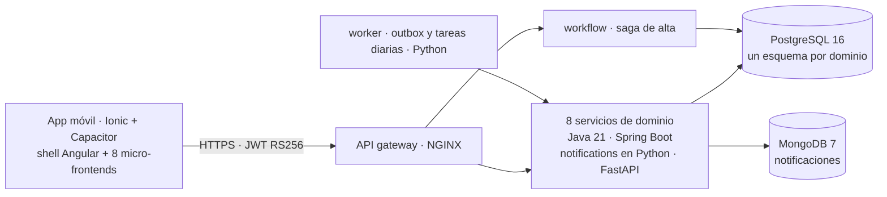

<!--
CONFIG
FULL_NAME: Daniel Felipe Cerquera Idrobo
GITHUB_USER: Pipecerquera
-->

**Daniel Felipe Cerquera Idrobo**  
*Estudiante de Ingeniería de Sistemas | Desarrollo de Software | Análisis y Modelado*  
📍 Santa María, Huila | Neiva, Huila  

### ¡Hola! 👋  
Soy Daniel Felipe Cerquera Idrobo, estudiante de Ingeniería de Sistemas en la Corporación Universitaria del Huila (Corhuila), actualmente en octavo semestre. Desde siempre, me ha apasionado el mundo del desarrollo de software y la tecnología, enfocándome en la construcción de soluciones innovadoras y eficientes.  

### Educación  
- **Ingeniería de Sistemas** (En curso) - *Corporación Universitaria del Huila (Corhuila)*  

### Habilidades Técnicas  
✅ Programación en Java y SQL  
✅ Desarrollo Backend con Spring Boot  
✅ Modelado de Bases de Datos SQL  
✅ Análisis y diseño de software  

### Enfoque Profesional  
Me interesa el desarrollo de software de calidad, siguiendo buenas prácticas y metodologías ágiles para garantizar soluciones escalables y mantenibles. Busco mejorar constantemente mis habilidades para aportar al crecimiento del sector tecnológico y la comunidad.  

### Proyecto destacado: BarberSaaS
Plataforma SaaS multi-barbería (reservas, agenda, fidelización, notificaciones, finanzas y administración de planes) construida en equipo como **sistema distribuido real** en el curso Sistemas Distribuidos 2026-B de Corhuila: 31 repositorios, 8 servicios de dominio, gateway, saga de alta de dueños, worker con outbox y una app móvil híbrida que carga 8 micro-frontends React y Angular. Versión final `v3.0.0` (2026-11-12), desplegada en Azure con HTTPS y presentada en vivo.

- **Código:** [organización code-corhuila](https://github.com/code-corhuila) (repositorios `barber-saas-*`, públicos) · arranque local con [infra-postgres](https://github.com/code-corhuila/barber-saas-infra-postgres/blob/v3.0.0/README.md).
- **Decisiones de arquitectura:** 21 ADRs (microservicios, motor de base por dominio, lenguaje por servicio, saga, transporte de eventos) en el repositorio de documentación del equipo, privado por norma del curso.
- **Demo:** [presentación final (PDF)](https://github.com/Pipecerquera/sistemas-distribuidos-2026-b-g2-daniel-cerquera/blob/main/15-week/hu-status/BarberSaaS-Sustentacion-Final.pdf) · [arranque desde cero y prueba de fallo](https://github.com/Pipecerquera/sistemas-distribuidos-2026-b-g2-daniel-cerquera/blob/main/15-week/hu-status/failure-path.md): con un servicio caído solo su función responde 503 y el resto sigue en pie.
- **Mi contribución:** dueño de 12 de los 31 repositorios — identity-auth (API, base y app), platform-admin (API, base y app), api-gateway, front, workflow, worker, infra-postgres e infra-mongo —; autenticación con JWT RS256 por audiencia y scope, saga de alta, outbox, despliegue en Azure, auditoría de seguridad y el release `v3.0.0` de los 31 repositorios. Registro semana a semana: [hu-status](https://github.com/Pipecerquera/sistemas-distribuidos-2026-b-g2-daniel-cerquera).

### Contacto  
📧 Correo electrónico: [Cerqueradanielfelipe@gmail.com]   
